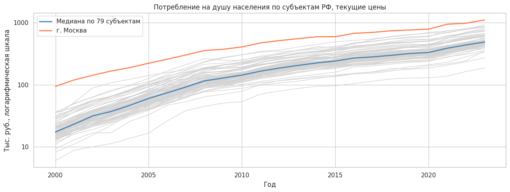
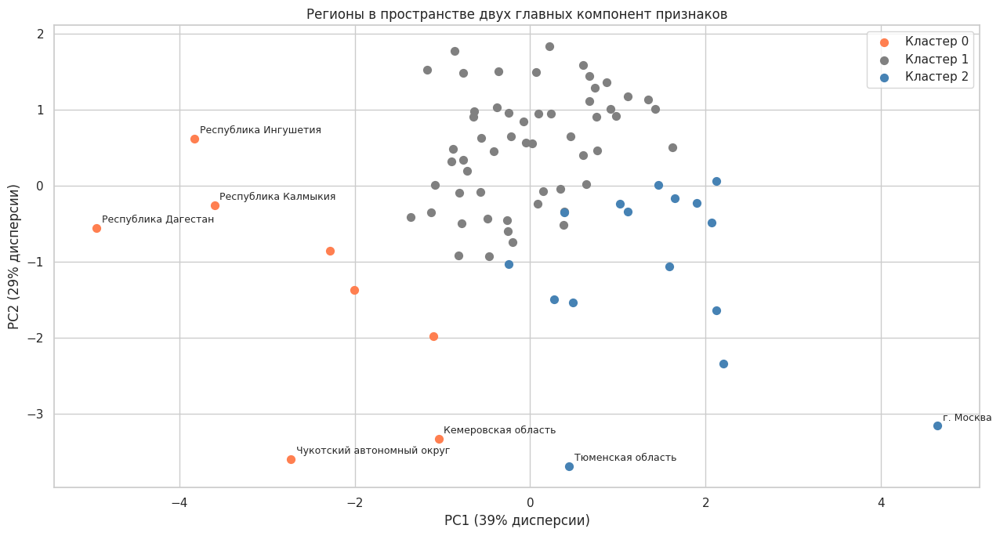
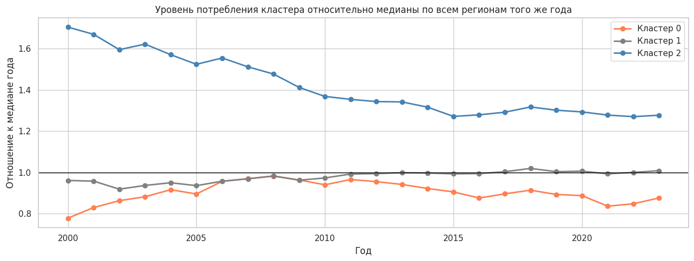
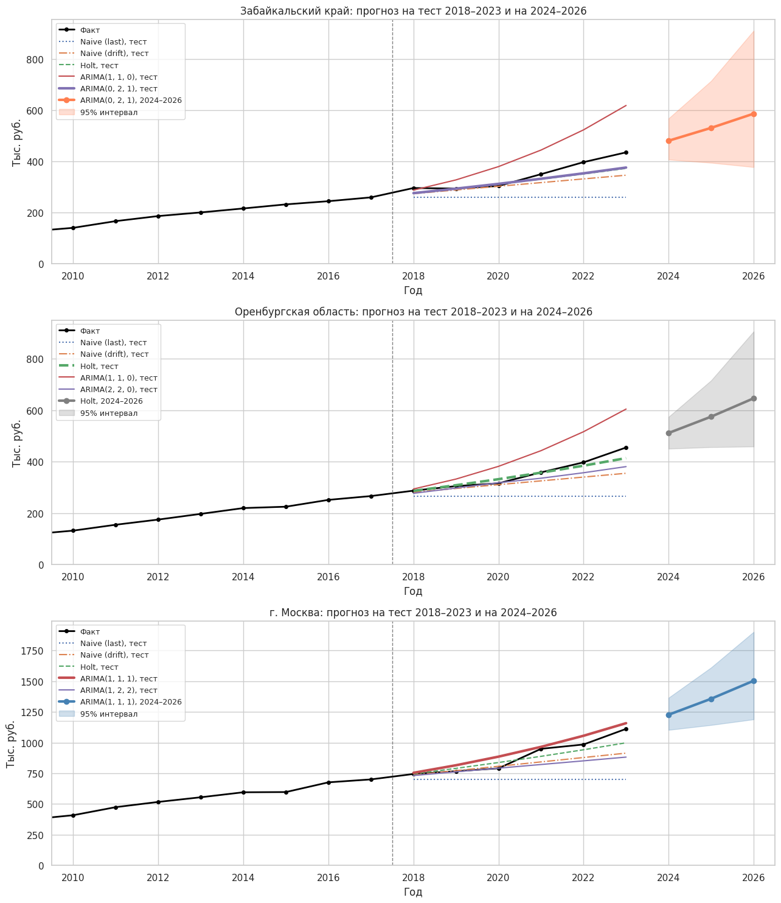
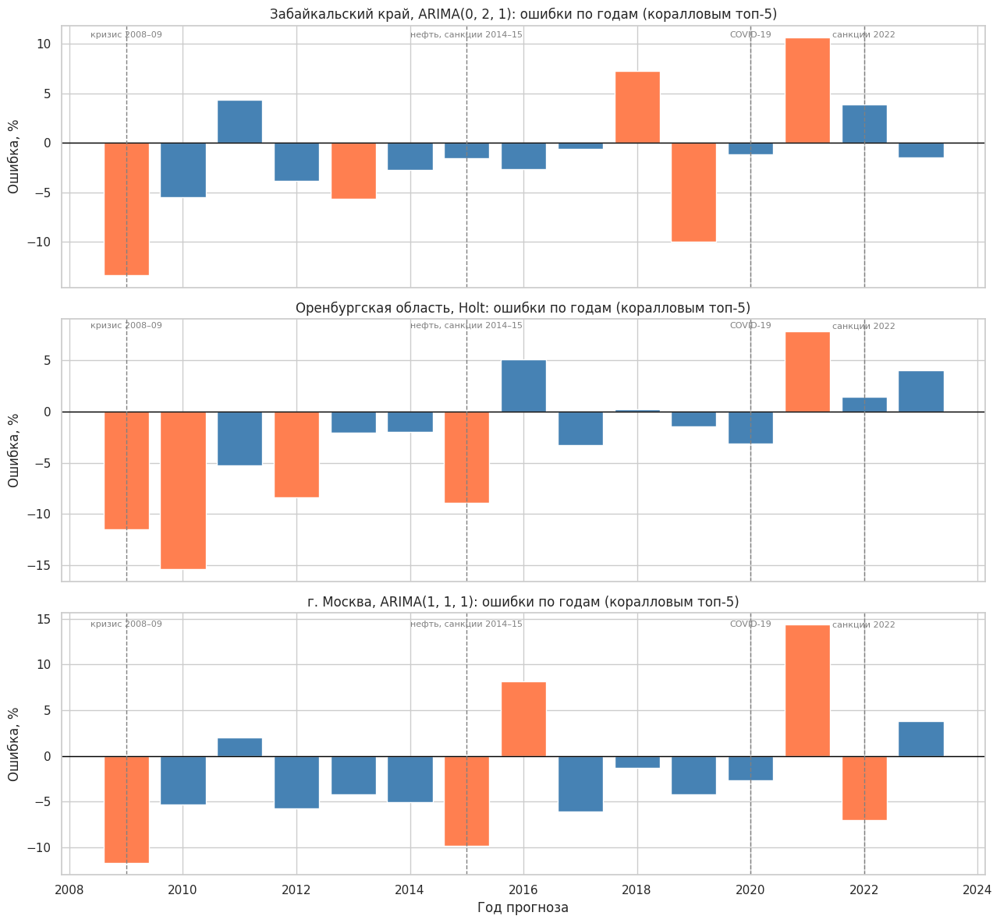

# Потребление домашних хозяйств в регионах России: кластеризация и прогноз

Итоговый проект по дисциплине «Временные ряды». Регионы России разбиты на группы по характеру динамики потребления на душу населения. Для представителя каждой группы ряд разобран (тренд, цикл, стационарность, ACF и PACF) и спрогнозирован моделями Holt и ARIMA, а наивный прогноз служит бейзлайном. Модели сравниваются на отложенной выборке и в расширяющемся окне, ошибки сопоставлены с экономическими событиями, для каждого региона даны рекомендации.

## Данные

Росстат, файл `rsdocs_1491005410458_wide_appendix_2025.csv`: фактическое конечное потребление домашних хозяйств на душу населения, рублей в текущих ценах, 2000–2023 годы. В файле 96 строк в широком формате (год в колонке): Россия в целом, 8 федеральных округов и субъекты.

Что нужно учесть до моделирования:

* Годовые колонки читаются как текст: десятичная запятая и два вида пропусков, пустая ячейка и символ «…».
* В названии Калининградской области одна буква латинская (U+0070), код региона пустой. Название исправлено, тип записи определяется по названию.
* В анализ входят 79 субъектов с полным рядом. Исключены округа, агрегаты «без автономного округа», Крым и Севастополь (нет 14 лет), Чечня (5 лет), НАО, ХМАО и ЯНАО (3 года). Тюменская и Архангельская области входят один раз, целиком.
* У Красноярского края значение 2004 года в 2,1 раза выше 2005 года и похоже на ошибку ввода. Оно заменено средним геометрическим соседних лет.
* Данные номинальные: медиана по регионам выросла за период в 28 раз, большую часть роста составляет инфляция. Поэтому для кластеризации используются относительные признаки, а модели обучаются на логарифме ряда.



## Структура

```
├── data/rsdocs_1491005410458_wide_appendix_2025.csv   исходные данные Росстата
├── notebooks/ts_final_project.ipynb                    все этапы: подготовка, кластеры, анализ рядов, прогноз, ошибки
├── reports/ts_final_report.docx                        отчёт со всеми графиками, таблицами и выводами
├── reports/figures/                                    графики для README
└── requirements.txt
```

## Запуск

Локально:

```
pip install -r requirements.txt
jupyter notebook notebooks/ts_final_project.ipynb
```

В Google Colab ноутбук открывается из GitHub без дополнительных шагов: первая ячейка ставит зависимости из `requirements.txt` репозитория, а данные читаются из `data/` или, если папки рядом нет, скачиваются по ссылке. Если pip заменит уже загруженный numpy или pandas, Colab попросит перезапустить сессию, после этого ячейку установки повторять не нужно.

Версии в `requirements.txt` те, на которых ноутбук выполнен в Colab.

## Протокол оценки

* Кластеризация: пять признаков ряда (уровень относительно медианы того же года, среднегодовой темп, замедление темпа между 2001–2011 и 2012–2023 годами, волатильность темпа вокруг его тренда, минимальный годовой темп), стандартизация, k-means и Уорд при k = 2, 3, 4. Число кластеров выбирается по силуэту и интерпретируемости групп.
* Регионы для прогноза: по одному из каждого кластера. Два ближайших к центроиду и Москва как предельный случай кластера 2.
* Разбиение: обучение 2000–2017 (18 точек, 75%), тест 2018–2023 (6 точек). Прогноз на будущее на 2024–2026 годы.
* Модели: `NaiveForecaster` из sktime со стратегиями `last` (бейзлайн задания) и `drift`, Holt и ARIMA на логарифме ряда. Порядок ARIMA подбирается по AIC на обучении отдельно для d = 1 со сносом и d = 2.
* Метрики RMSE и MAPE на исходной шкале. Лучшая модель выбирается по RMSE на тесте.
* Устойчивость: расширяющееся окно с прогнозом на год вперёд, от окна 2000–2008 до 2023 года, 15 прогнозов. Эти же ошибки используются для анализа топ-5 ошибок.

## Результаты

Кластеры (k-means, k = 3, силуэт 0,264):

| Кластер | Регионов | Уровень к медиане | Темп в год | Замедление темпа, п.п. | Волатильность темпа, п.п. | Мин. годовой темп |
|---|---|---|---|---|---|---|
| 0, рост с откатами | 8 | −10% | 16,2% | −17,4 | 11,1 | −3,4% |
| 1, ровный рост у медианы | 55 | −2% | 15,8% | −13,8 | 6,9 | +2,4% |
| 2, высокий уровень, медленный рост | 16 | +41% | 14,2% | −11,6 | 7,0 | +0,5% |




MAPE на тесте 2018–2023, %:

| Регион (кластер) | Naive (last) | Naive (drift) | Holt | ARIMA, d = 1 | ARIMA, d = 2 |
|---|---|---|---|---|---|
| Забайкальский край (0) | 23,27 | 9,36 | 6,86 | 23,33 (1, 1, 0) | 6,55 (0, 2, 1) |
| Оренбургская область (1) | 22,63 | 8,74 | 3,17 | 19,73 (1, 1, 0) | 6,59 (2, 2, 0) |
| г. Москва (2) | 19,69 | 7,28 | 5,03 | 5,46 (1, 1, 1) | 8,36 (1, 2, 2) |

Лучшие модели по RMSE: ARIMA(0, 2, 1) для Забайкальского края (32,1 тыс. руб.), Holt для Оренбургской области (18,9 тыс. руб.), ARIMA(1, 1, 1) для Москвы (56,2 тыс. руб.). В расширяющемся окне MAPE на тех же годах 5,64%, 2,91% и 5,36%.

Прогноз лучших моделей на 2026 год, тыс. руб. на душу населения: Забайкальский край 585,8 (95% интервал 377–910), Оренбургская область 646,7 (459–907), Москва 1503,1 (1189–1901).




## Выводы

Регионы различаются прежде всего тем, как затухал рост. В кластерах 0 и 1 темп упал с 25–40% в начале 2000-х до 5–10%, и там выигрывают модели, которые продолжают последний темп (Holt и ARIMA с d = 2). Модель с постоянным средним темпом, ARIMA(1, 1, 0) со сносом, на этих рядах хуже наивного сноса: её снос равен среднему темпу 2001–2017 годов, и прогноз уходит вверх. В Москве темп замедлялся мягче всего, и модель с d = 1 работает.

Все лучшие модели обгоняют оба наивных прогноза, у сноса они выигрывают от 1,8 до 5,6 п.п. MAPE. Обновление модели каждый год снижает ошибку только на 0,1–0,9 п.п.: ошибку определяет неожиданность года, а не длина горизонта.

Ошибки систематические. В 2009–2017 годах прогноз на год вперёд завышен в 7–8 годах из 9, потому что модели продолжают прошлый, более высокий темп. Крупнейшие ошибки приходятся на кризис 2009 года (у всех трёх регионов), 2015 год (Оренбургская область и Москва), отскок 2021 года (у всех трёх) и 2022 год (Москва). Сам 2020 год в топ-5 не попал: пандемия видна в ошибке на следующий год.

Сближение богатых регионов с остальными шло до 2015 года (уровень кластера 2 упал с 1,71 до 1,27 медианы) и остановилось. По прогнозу отношение Москвы к Забайкальскому краю в 2026 году то же, что в 2023 (2,6 раза).

## Ограничения работы

Ряды номинальные: модели прогнозируют рост цен и физического потребления вместе, и 10–12% в год нельзя читать как рост уровня жизни. В ряду 24 годовые точки, на обучении 18, поэтому тест Дики–Фуллера, ACF и PACF имеют низкую мощность, а AIC трёх лучших моделей различается меньше чем на 1,5. Модели одномерные и узнают о шоке только через год. Каждый кластер представлен одним регионом, и выводы о лучшей модели для группы на других регионах не проверялись. Интервалы прогноза предполагают, что будущие шоки будут не сильнее прошлых.

## Что можно улучшить

* Дефлировать ряды региональными индексами цен и прогнозировать реальное потребление.
* Добавить внешние переменные (инфляция, цена нефти, реальные доходы) через ARIMAX.
* Обучить одну панельную модель темпов роста на всех 79 регионах и проверить выводы по каждому кластеру целиком.
* Проверить Holt с затухающим трендом и комбинацию Holt и ARIMA.
